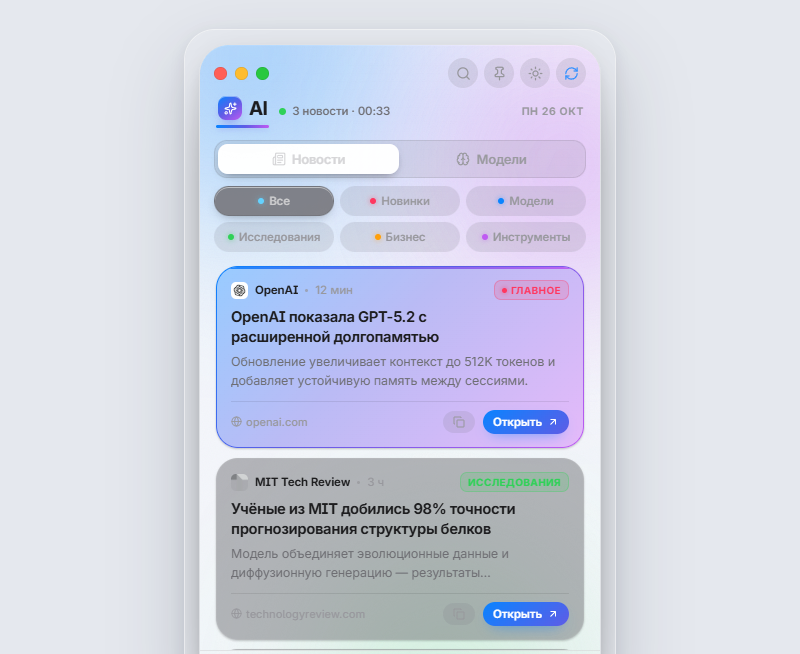
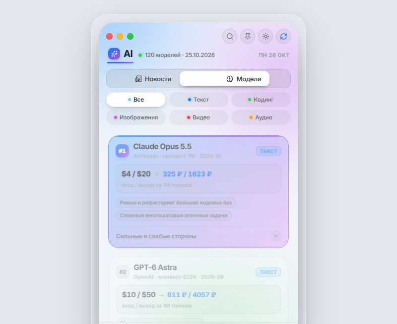

<div align="center">

# 🤖 AI News Widget

**Десктопный виджет новостей ИИ в стиле Apple** — стеклянное окно с размытием,
живые градиенты, «светофор» macOS, типографика в духе SF Pro.

Electron 33 · чистый HTML/CSS/JS · **без единого фреймворка**

[](https://github.com/PozzE/ai-news-widget/releases/latest)
[](https://github.com/PozzE/ai-news-widget/actions/workflows/build.yml)
[](LICENSE)
[](https://www.electronjs.org/)
[](#-каталог-моделей)

[Скачать установщик](#-установка) · [Возможности](#-возможности) · [Запуск из исходников](#-запуск-из-исходников) · [Каталог моделей](#-каталог-моделей)

</div>

---

<p align="center">
  
    
  
</p>

---

## 📑 Содержание

- [📥 Установка](#-установка)
- [✨ Возможности](#-возможности)
- [⌨️ Горячие клавиши](#️-горячие-клавиши)
- [🚀 Запуск из исходников](#-запуск-из-исходников)
- [🏗 Сборка .exe](#-сборка-exe)
- [📁 Структура проекта](#-структура-проекта)
- [🧠 Каталог моделей](#-каталог-моделей)
- [🎨 Ассеты](#-ассеты)
- [📡 Источники новостей](#-источники-новостей)
- [⚙️ Настройки](#️-настройки)
- [📄 Лицензия](#-лицензия)

---

## 📥 Установка

1. Откройте **[страницу релизов](https://github.com/PozzE/ai-news-widget/releases/latest)**
2. Скачайте **`AI-News-Widget-Setup-1.0.0.exe`**
3. Запустите файл и следуйте мастеру установки
4. Ярлык **AI News Widget** появится на рабочем столе и в меню «Пуск»

> **Windows SmartScreen / Smart App Control.** Приложение open-source и не подписано
> коммерческим сертификатом, поэтому Windows может показать предупреждение.
> Нажмите **«Подробнее» → «Всё равно запустить»**. Исходный код полностью открыт —
> проверить его можно прямо здесь, в репозитории.

---

## ✨ Возможности

| | |
|---|---|
| 🤖 **Вкладка AI** | главная вкладка раздела, внутри две подвкладки — **Новости** и **Модели** |
| 📰 **Новости** | лента из 12 RSS-источников + фильтры: Новинки · Модели · Исследования · Бизнес · Инструменты |
| 🧠 **Модели** | **120 моделей ИИ** — не только топовые, но и дешёвые, open-weight и нишевые; отсортированы от лучшей к худшей, у каждой — цена в **USD и RUB**, сильные и слабые стороны, назначение |
| 🏷 **Категории моделей** | фильтр: Текст · Кодинг · Изображения · Видео · Аудио |
| 💱 **Живой курс** | USD → RUB из открытых API (3 источника + фоллбэк), кэш на 12 часов |
| 📡 **12 RSS-источников** | OpenAI, Google AI, TechCrunch, VentureBeat, MIT Tech Review, The Verge, WIRED, Ars Technica, arXiv, Interconnects, Hacker News, Хабр |
| 🔄 **Автообновление** | каждые 10 минут, дедупликация, кэш на диске — офлайн покажет сохранённое |
| 🔍 **Поиск** | `Ctrl+F`, живая фильтрация — в новостях и в каталоге моделей |
| 🖼 **Картинки и фавиконы** | превью из RSS + иконки источников с двойным фоллбэком |
| 🌗 **Темы** | светлая / тёмная, переключатель в шапке |
| 📌 **Поверх окон** | виджет всегда поверх, крестик — сворачивание в трей, приложение не завершается |
| 📦 **Компактный режим** | зелёная кнопка `⤢` — мини-виджет 340×356 с ротацией главного |
| 🔦 **Трей** | двойной клик по иконке вызывает виджет, меню с настройками |

---

## ⌨️ Горячие клавиши

| Клавиша | Действие |
|---|---|
| `Ctrl+F` | поиск |
| `Ctrl+R` | обновить ленту |
| `Esc` | закрыть поиск |
| `Alt + ←/→` | переключить вкладку |
| `Колесо по шапке` | листать фильтры-чипы |

---

## 🚀 Запуск из исходников

### Вариант 1 — двойной клик
Откройте файл **`Запустить виджет.cmd`**.

### Вариант 2 — из VS Code
1. Откройте папку `ai-news-widget` в VS Code (`code .`)
2. Нажмите **F5** → конфигурация **«▶ Запустить виджет»**

### Вариант 3 — терминал

```bash
git clone https://github.com/PozzE/ai-news-widget.git
cd ai-news-widget
npm install
npm start
```

### Предпросмотр дизайна в браузере (без Electron)

```bash
npm run preview     # → http://localhost:8787/renderer/index.html
```

В этом режиме подставляется мок-API, а если рядом лежит `preview-news.json` —
показываются настоящие новости из кэша.

---

## 🏗 Сборка .exe

```bash
npm run dist     # NSIS-установщик → dist/AI-News-Widget-Setup-1.0.0.exe
npm run pack     # распакованная версия → dist/win-unpacked/
```

Сборка выполняется **автоматически на GitHub Actions** при каждом пуше и при
теге `v*`: см. [`.github/workflows/build.yml`](.github/workflows/build.yml).
Готовый установщик попадает в артефакты workflow и в **Releases**.

> ⚠️ **Windows Smart App Control.** На машинах, где включён Smart App Control
> (Windows 11, чистая установка), локальная сборка NSIS падает с ошибкой
> `spawn UNKNOWN`: система блокирует запуск свежесозданного неподписанного exe,
> который electron-builder использует для генерации деинсталлятора.
> На GitHub Actions эта политика не действует — сборка проходит штатно.

---

## 📁 Структура проекта

```
ai-news-widget/
├── main.js                 главный процесс: окно, трей, RSS, кэш, курс, IPC
├── preload.js              мост renderer ↔ main (contextBridge)
├── models.json             каталог из 120 моделей ИИ (цены, плюсы/минусы, категории)
├── package.json            скрипты + конфигурация electron-builder
├── .github/workflows/
│   └── build.yml           CI: сборка установщика и публикация релиза
├── renderer/
│   ├── index.html          разметка: вкладка AI → [Новости | Модели]
│   ├── styles.css          дизайн-система (токены, стекло, карточки моделей)
│   └── app.js              лента, каталог моделей, фильтры, поиск, режимы
├── assets/
│   ├── icons/*.svg         52 иконки Lucide (скачаны с unpkg)
│   ├── icons/icons.json    те же иконки, отдаются в renderer одним файлом
│   ├── fonts/*.woff2       Inter Variable (скачан с rsms.me) — SF-alike
│   └── icon.png/.ico       иконки приложения, сгенерированы из SVG
├── docs/
│   ├── screenshot-news.png скриншот ленты новостей
│   └── screenshot-models.png скриншот каталога моделей
├── tools/
│   ├── gen-icons.js        растеризация SVG → PNG/ICO через Electron
│   └── serve.js            локальный сервер для предпросмотра
└── .vscode/launch.json     конфигурации запуска (F5)
```

---

## 🧠 Каталог моделей

`models.json` отдаётся главным процессом по IPC и целиком редактируется руками:

```jsonc
{
  "updated": "2026-10-25",
  "categories": [ { "id": "image", "label": "Изображения", "color": "#BF5AF2" } ],
  "items": [{
    "id": "claude-opus-5-5", "name": "Claude Opus 5.5", "vendor": "Anthropic",
    "rank": 1,                       // место в общем рейтинге (меньше → лучше)
    "cats": ["text", "code"],        // в каких категориях показывать
    "ctx": "1M", "rel": "2026-10", "site": "https://anthropic.com",
    "pricing": { "in": 4, "out": 20, "unit": "1M токенов" },
    "strengths": ["…"], "weaknesses": ["…"], "best": ["…", "…"]
  }]
}
```

Формы `pricing`:

| Запись | Что рисует |
|---|---|
| `{ "in": 4, "out": 20, "unit": "1M токенов" }` | `$4 / $20 → 325 ₽ / 1623 ₽` |
| `{ "amount": 0.04, "unit": "изображение" }` | `$0.04 → 3.25 ₽` за изображение |
| `{ "free": true, "text": "Бесплатно · open-weight" }` | `Бесплатно → 0 ₽` |
| `{ "text": "от $10/мес", "unit": "подписка" }` | только текст, без пересчёта |

Рублёвая цена пересчитывается по **живому курсу** (см. «Настройки»).
Добавить модель — допишите объект в `items` и поднимите/опустите `rank`.

---

## 🎨 Ассеты

Всё скачано, ничего не нарисовано вручную:

| Ресурс | Источник | Лицензия |
|---|---|---|
| Иконки интерфейса | [`unpkg.com/lucide-static`](https://unpkg.com/lucide-static/) | ISC |
| Шрифт Inter Variable | [`rsms.me/inter`](https://rsms.me/inter/) | SIL OFL |
| Иконки OpenAI/Google | [`unpkg.com/simple-icons`](https://unpkg.com/simple-icons/) | CC0 |
| Иконки приложения | собраны из Lucide SVG скриптом `tools/gen-icons.js` | ISC |

Обновление иконок: `npm run icons`.

---

## 📡 Источники новостей

`main.js` → массив `FEEDS`:

```js
{ name: 'OpenAI', url: 'https://openai.com/news/rss.xml', cat: 'models' }
```

Добавьте свой источник одной строкой — категории, дедупликация и кэш работают
автоматически. Если какой-то источник недоступен (блокировки, 403, таймаут),
виджет продолжает работать на остальных и показывает счётчик в нижней панели.

---

## ⚙️ Настройки

Хранятся в `%APPDATA%\AI News Widget\prefs.json`:

- `theme` — `system` | `light` | `dark`
- `pinned` — поверх всех окон
- `compact` — компактный режим

Кэш новостей — `news-cache.json` рядом.

**Курс рубля** — `rate.json` рядом (обновляется раз в 12 часов):

```js
{ "rate": 81.140284, "live": true, "src": "open.er-api.com" }
```

Источники по очереди: `open.er-api.com` → `api.exchangerate-api.com` →
`cdn.jsdelivr.net` (fawazahmed0/currency-api). Если все недоступны — берётся
сохранённый курс, а при его отсутствии фиксированный `81`.

---

## 📄 Лицензия

[MIT](LICENSE) © PozzE
